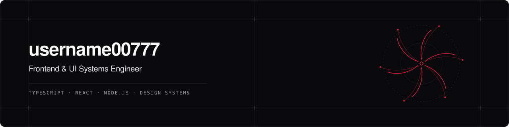

<picture>
  <source media="(prefers-color-scheme: dark)" srcset="assets/banner-dark.svg" />
  <source media="(prefers-color-scheme: light)" srcset="assets/banner-light.svg" />
  
</picture>

 

**Frontend & UI Systems Engineer** — designing and building fast, typographically rigorous web interfaces, modular frontend architectures, and clean full-stack applications.

`Status` **Open to Frontend / Full-Stack roles** &nbsp;·&nbsp; `Focus` **TypeScript · React · Node.js · UI Systems**

---

### Core Stack

- **Frontend & UI:** `TypeScript` · `React` · `Next.js` · `HTML5 / Modern CSS` · `Tailwind CSS` · `State Management`
- **Backend & Logic:** `Node.js` · `Express` · `RESTful APIs` · `Client/Server Architecture` · `Edge Runtimes`
- **Architecture & Quality:** `Component Design Systems` · `Responsive Grids` · `Web Performance` · `Accessibility (a11y)`
- **Environment & Workflow:** `Git` · `GitHub Actions` · `Vite` · `Vercel`
